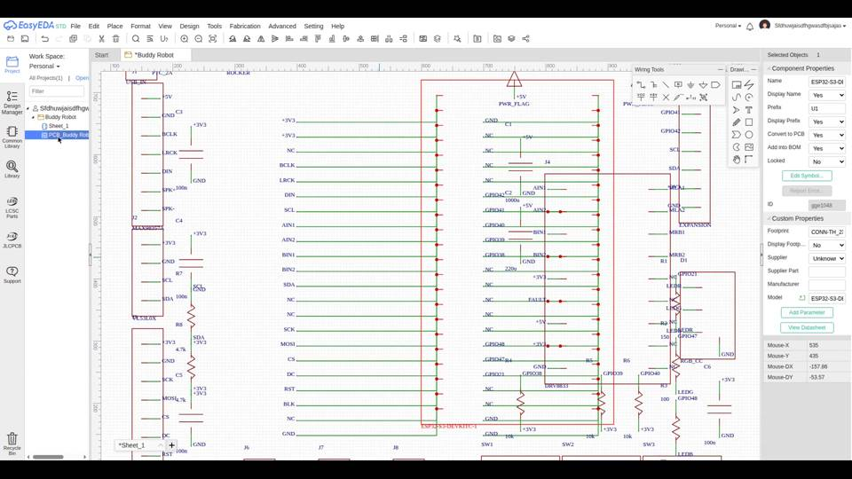

# buddy

buddy is a small desk companion robot i'm building with an esp32-s3 as its brain, a screen for its face, and two motors so it can move around. eventually, i want it to talk, react to people, show different expressions, and have a bit of its own personality.

## what is buddy?

the idea behind buddy is to make a friendly little robot for older adults who might want more conversation and interaction in their day. i want it to feel more like a companion than just another electronic device sitting on a desk.

the plan is for buddy to have a screen that shows expressions, a microphone and speaker for talking, sensors to understand what's around it, and wheels that let it move. i'd also like it to react to touch and respond to simple commands.

these features are still being worked on, so buddy isn't a finished product yet. the goal is to make something that people would actually enjoy using, not just a robot that looks cool in a demo. buddy isn't meant to replace family, caregivers, or professional help.

## why am i building it?

buddy started as my project for hack club half life, a 10-week program where i work on hardware and build something new each week.

i wanted to try making a real robot instead of just writing software or building another basic electronics project. it also gives me a chance to learn pcb design, cad, embedded programming, motor control, and eventually audio and voice interaction.

i'm keeping this repo as a record of the whole process. that includes the designs, parts, code, decisions, and mistakes along the way. i know there's a lot left to figure out, but i want to build it one step at a time and improve it as i go.

## what i want buddy to do

these are the main features i'm working toward:

- **face:** a display with animated eyes, blinking, expressions, and animations for listening or talking.
- **voice:** a microphone and speaker so buddy can hear someone and respond with spoken conversation.
- **movement:** two geared dc motors that let it move forward, backward, and turn.
- **sensors:** a distance sensor to detect nearby objects, along with other sensors to help understand movement and orientation.
- **personality:** reactions to touch, sounds, and conversations, plus small behaviours when nobody is interacting with it.
- **wireless control:** a separate controller for testing movements and triggering actions.
- **power:** a properly designed power system for the electronics, audio, and motors.

the esp32-s3 will handle the hardware and local control. for actual ai conversation, i plan to use a suitable speech or ai service instead of trying to train my own model from scratch.

## where i'm at right now

i'm still in the early stages, and the robot itself isn't finished yet.

| week | task | status |
|---|---|---|
| 1 | pcb schematic in easyeda | done and submitted |
| 2 | chassis cad in onshape | in progress |
| 3+ | pcb layout, firmware, assembly, and personality | not started |

the schematic has been designed, but the pcb hasn't been routed or ordered yet. i'm working on the chassis next, followed by the electronics and firmware.

here's the actual chassis cad from week 2, designed in onshape — base, face frame, and top shell:

## bill of materials (week 1)

here are the main parts in my first hardware plan, along with the prices i used when putting the design together.

| part | what it's for | qty | unit price | total |
|---|---|---:|---:|---:|
| [esp32-s3-devkitc-1-n16r8](https://www.amazon.com/dp/B0FPLVCTQD) | main controller for the robot | 1 | $9.99 | $9.99 |
| [1.47-inch st7789 spi tft lcd](https://www.amazon.com/dp/B0F4DX2N4J) | display for buddy's face | 1 | $8.99 | $8.99 |
| [drv8833 motor driver](https://a.co/d/0eZ6dFTn) | controls the two dc motors | 1 | $4.99 | $4.99 |
| [elegoo electronics kit](https://www.amazon.com/dp/B01ERP6WL4) | resistors, capacitors, rgb led, buttons, and headers | 1 | $9.99 | $9.99 |
| [capacitor assortment kit](https://www.amazon.com/dp/B0C1VBXCQM) | capacitors for the motor power rail | 1 | $9.99 | $9.99 |
| [screw terminal 10-pack](https://www.amazon.com/dp/B0FPCJRJTY) | connections for power and motor wires | 1 | $6.99 | $6.99 |
| [rocker switch 5-pack](https://www.amazon.com/dp/B07GNHMY3B) | main power switch | 1 | $6.49 | $6.49 |
| **parts subtotal** | | | | **$57.43** |

this is the total for the listed week 1 parts, not the final cost of a complete buddy. i'll probably need additional components and other parts as the build moves forward.

the full bill of materials, including component names and footprints, is in [`hardware/exports/bom.csv`](hardware/exports/bom.csv).

## how it works

the esp32-s3 is the main controller. it connects to the display, motor driver, and sensors, and will eventually handle audio input and output too.

here's the actual week 1 schematic as designed in easyeda:

the basic plan is:

- the display shows buddy's face and expressions.
- the motor driver controls the left and right motors.
- the sensors help detect nearby objects and movement.
- the microphone and speaker will support voice interaction.
- the firmware connects everything and decides how buddy responds.

i'm trying to plan the electronics properly before committing to a finished board. motors and audio can cause power and noise problems, so those are things i need to think about during the design instead of trying to fix everything at the end.

this is still a work in progress, and things will probably change as i build and test it. i'll keep updating the repo as i make progress, including the stuff that doesn't work the first time.
