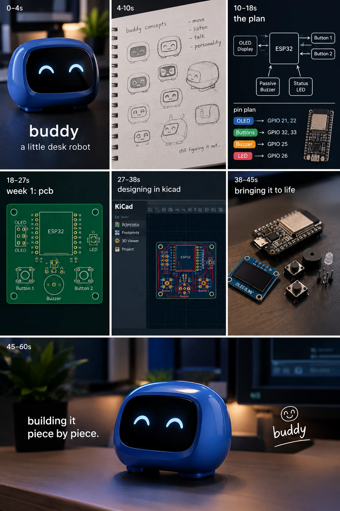

# buddy

**what it is:** a small autonomous desk companion robot with a personality — an esp32-s3 brain, a display face, two dc motors for wheels, and (in later weeks) a mic and speaker so it can hear and talk back.

**what it does:** this repo is the design record for buddy's electronics. week 1 of the build is the pcb: the full schematic, designed in easyeda — esp32-s3 devkit, st7789 display, drv8833 motor driver, buttons, leds, and power protection. 33 components, 39 nets. the board isn't routed or ordered yet; that's the next step.

**why it exists:** buddy is my hack club half life project — a 10-week program, one themed build per week, each with a parts grant. week 1's theme is "design your pcb." this repo is the real record of the whole build, including the parts i get wrong.

---

## bill of materials (week 1)

| part | what it's for | qty | unit | total |
|---|---|---|---|---|
| [esp32-s3-devkitc-1-n16r8](https://www.amazon.com/dp/B0FPLVCTQD) | main microcontroller, runs the firmware and controls everything | 1 | $9.99 | $9.99 |
| [tft lcd 1.47in st7789 spi](https://www.amazon.com/dp/B0F4DX2N4J) | display for buddy's face | 1 | $8.99 | $8.99 |
| [drv8833 motor driver](https://a.co/d/0eZ6dFTn) | dual motor driver for the two dc motors | 1 | $4.99 | $4.99 |
| [elegoo electronics kit](https://www.amazon.com/dp/B01ERP6WL4) | resistors, ceramic caps, rgb led, buttons, and headers for the pcb | 1 | $9.99 | $9.99 |
| [capacitor assortment kit](https://www.amazon.com/dp/B0C1VBXCQM) | bulk capacitors for the motor power rail | 1 | $9.99 | $9.99 |
| [screw terminal 10-pack](https://www.amazon.com/dp/B0FPCJRJTY) | power input and motor output wire connections | 1 | $6.99 | $6.99 |
| [rocker switch 5-pack](https://www.amazon.com/dp/B07GNHMY3B) | main power on/off switch | 1 | $6.49 | $6.49 |
| **parts subtotal** | | | | **$57.43** |

machine-readable version with designators and footprints: [hardware/exports/bom.csv](hardware/exports/bom.csv)

---



that's the look i'm aiming at. it's concept art — not hardware that exists.

---

## the shape of it

```
                 ┌─────────┐
                 │ display │
                 │  FACE   │
                 └────┬────┘
                      │   ┌────── speaker
 microphone ──────┐   │   │
                  ↓   ↓   ↓
               ┌─────────────┐
               │  ESP32-S3   │
               │    BRAIN    │
               └──────┬──────┘
                      │
          ┌───────────┼───────────┐
          ↓           ↓           ↓
       sensors     controller   motors
          │                       │
       IMU / ToF              left/right
                               wheels
```

the full spec — every subsystem, the software layers, and the parts i think are
risky — is in **[docs/00-vision.md](docs/00-vision.md)**.

## the short version

| system | what it is |
|---|---|
| brain | esp32-s3 module — wi-fi, ble, and i2s hardware for audio |
| face | a proper display, bigger than a tiny oled. blinks, expressions, animations |
| ears | digital microphone, so it can hear "hey buddy" |
| voice | i2s amp into a speaker — real speech, not buzzer beeps |
| movement | two geared dc motors with encoders, dual motor driver on the board |
| senses | distance sensor, imu, touch sensor on the head |
| control | wireless controller with a joystick and action buttons |
| power | rechargeable battery, charging circuit, separate power path for the motors |

## where i'm at

| week | what | state |
|---|---|---|
| 1 | pcb schematic in easyeda | done, submitted |
| 2 | chassis cad in onshape | in progress |
| 3+ | board layout, firmware, assembly, personality | not started |

the schematic is designed but the board isn't routed or ordered yet. week 2 (the chassis) is underway.

## repo layout

```
buddy/
├── docs/            the plan and the notes
├── hardware/        easyeda schematic, kicad reference, exports
├── firmware/        esp32-s3 bring-up code
├── journal/         devlog, one file per session
├── media/           renders, reel assets, build photos
└── README.md
```

## notes

- [00 — the whole thing](docs/00-vision.md) — the full target: move, talk, face, personality, senses
- [week 1 reel](docs/reel-week1.md) — the 21s cut, timeline and voiceover

## a note on the warm-up

before this i built [buddy-mini](https://github.com/nadellasripad11/buddy-mini), a
breadboard prototype with an oled face, two buttons and a buzzer. it was how i
learned which esp32 pins are safe and how the parts actually work. **its pin
plan does not carry over** — buddy is an esp32-s3 with motors, audio and sensors, which
is a different board entirely.

## time

hours go through hackatime under project `buddy`. only time actually spent on this
counts.
